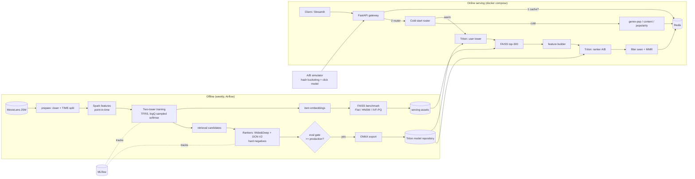
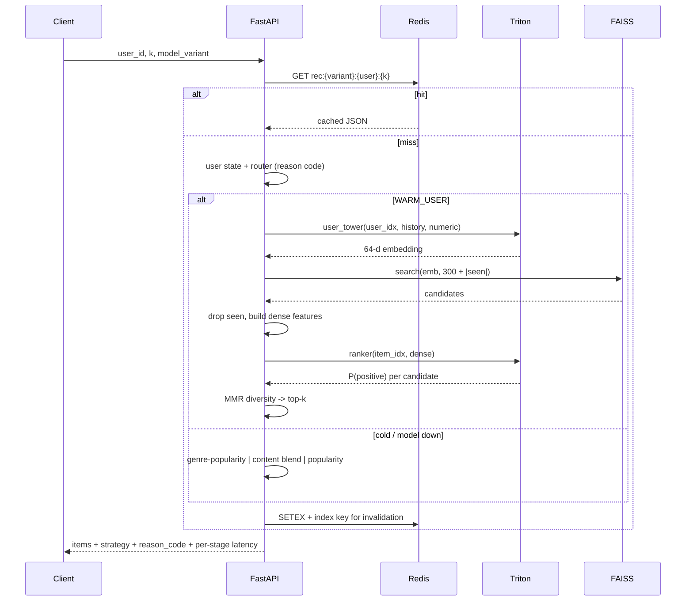

# Architecture

## System diagram



## Request flow (`POST /recommend`)



## Data flow and time windows

```
time ──────────────────────────────────────────────────────────────────────▶
|<──── retrieval-train 70% ────>|<─ ranker-train 10% ─>|<─ val 10% ─>|<─ test 10% ─>|
0                               t1                     t2            t3
```

| Stage | Window | State frozen at | What trains / evaluates |
|---|---|---|---|
| retrieval-train | [0, t1) | each example's own time | two-tower, SVD baseline |
| ranker-train | [t1, t2) | t1 | rankers learn on retrieval candidates; labels = true positives in window |
| validation | [t2, t3) | t2 | model selection, gate metrics, ablations |
| test | [t3, ∞) | t3 | A/B replay, serving assets (latest state) |

The ranker is trained on candidates produced by a retrieval model that **never saw those
labels**, so its score distribution matches serving (the usual failure of training a ranker on
the retrieval model's own training data is avoided).

## Key design decisions (interview answers)

| Decision | Why |
|---|---|
| Time split, three cutoffs | Random splits leak future behaviour and inflate metrics; production predicts the future. Tests prove invariance to future data. |
| In-batch sampled softmax + **logQ correction** | In-batch negatives are sampled ∝ popularity, which over-penalises popular items; subtracting log q(item) de-biases the logits. Accidental hits removed. |
| L2-normalised 64-d embeddings, temperature 0.05 | Inner product = cosine; bounded scores make ANN and the ranker's retrieval-score feature stable. |
| ID dropout in both towers | Trains the content-only path so **new items and new users** get usable embeddings with no retraining. |
| Index choice by measurement | Benchmark script picks the lowest-p95 index reaching target recall@100 vs exact (default 0.95). HNSW usually wins on latency, IVF-PQ on memory. |
| Two rankers (Wide&Deep, DCN-V2) | Needed for the A/B test; Wide&Deep memorises user-genre × item-genre crosses, DCN-V2 learns explicit feature crosses. |
| ONNX on Triton (not TF SavedModel) | Triton's TF backend lags TensorFlow versions; ONNX Runtime CPU is stable and verified numerically at export. |
| Shared `candidate_dense` | One function builds ranker features offline and online → no train/serve skew. |
| Graceful degradation | Model errors fall back to popularity with reason code `MODEL_UNAVAILABLE_POPULARITY`; the API never 5xx's because Triton is down. |
